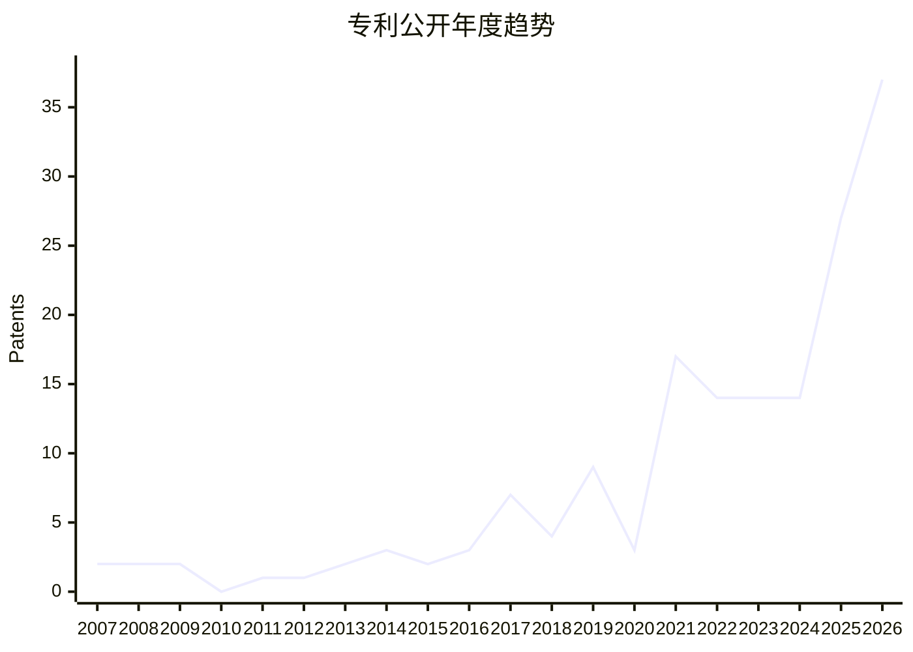
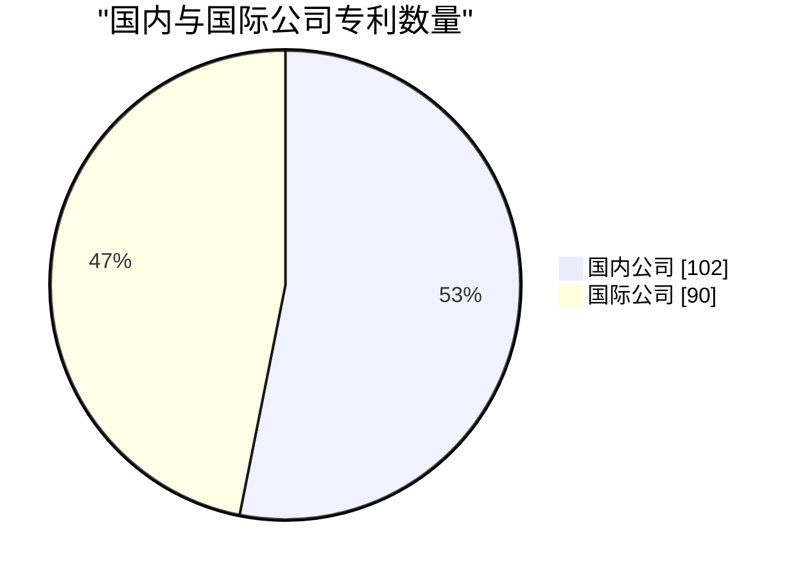

> This file was generated by [README.tpl](README.tpl) via [yaml-readme](https://github.com/LinuxSuRen/yaml-readme), please don't edit it directly!

# 📜 Awesome Patent

**具身智能（Embodied AI）专利精选：按技术领域与公司两个维度收录人形机器人、操作大模型、灵巧手等方向的代表性专利，持续更新**

已收录 **192** 条专利 · 覆盖 **103** 家公司 / 机构 · **9** 个技术领域分类（见[目录](#目录)）

## 专利全景脑图

```mermaid
mindmap
  root((具身智能专利))
    Actuator & Structure
      HUMANOID ROBOT · 1X Technologies, Inc.
      HUMANOID ROBOT · 1X Technologies, Inc.
      人形机器人 · 北京加速进化科技有限公司
      Modular robotic linkages and methods of assembling a robot manipulator · Amazon Technologies, Inc.
      Foot for Legged Robot · ANYbotics AG
      Robotic manipulator having a plurality of spring compensated joints · Apptronik, Inc.
      HUMANOID ROBOT · Apptronik, Inc.
      DYNAMIC ROBOT ACTUATOR · Apptronik, Inc.
      传动机构及机器人 · 星尘智能（深圳）有限公司
      下肢结构、连续关节结构以及机器人 · 星尘智能（深圳）有限公司
      机器人关节减速电机及机器人 · 深圳市越疆科技股份有限公司
      HIP ASSEMBLY AND KINEMATICS OF A HUMANOID ROBOT · Figure AI, Inc.
      Robot system and method for controlling a robot system · Franka Emika GmbH
      Wave gear device · Harmonic Drive Systems Inc
      一种沿双圆管轨道运行巡检机器人的四驱磁吸轮驱动机构 · 中信重工开诚智能装备有限公司
      Dual-arm robot shoulder width limiting device and dual-arm robot equipped with the device · Kawada Industries, Inc.
      一种换流站阀厅巡检机器人使用的组合式轨道 · 科大智能科技股份有限公司
      一种变电站巡检机器人新型驱动转向装置 · 科大智能科技股份有限公司
      巡检机器人用轨道限位器及轨道限位系统 · 深圳市朗驰欣创科技股份有限公司
      致动器，关节模组及机器人 · 深圳逐际动力科技有限公司
      Rotary actuator · Nabtesco Corporation
      中空内气管人形机械臂 · 上海穹彻智能科技有限公司
      Series elastic actuator, method for controlling series elastic actuator and system thereof · Rainbow Robotics Co., Ltd.
      磁性绝对角度编码器和机器人 · 睿尔曼智能科技（北京）股份有限公司
      清洁机器人及清洁系统 · 北京石头世纪科技股份有限公司
      人形机器人的腿部结构和具有其的人形机器人 · 北京星动纪元科技有限公司
      机器腿组件和机器人 · 北京星动纪元科技有限公司
      Systems, devices, and methods for a robotic joint · Sanctuary Cognitive Systems Corporation
      头部转动装置及机器人 · 松延动力（北京）科技有限公司
      一种机器人并联同轴输出关节模组 · 北京松延动力科技集团股份有限公司
      SYSTEMS AND METHODS FOR A ROBOT KNEE JOINT ASSEMBLY · Tesla, Inc.
      一种机器人的头部组件及机器人 · 优理奇机器人科技（苏州）有限公司
      Highly integrated high-performance robot joint unit · Hangzhou Yushu Technology Co., Ltd. （Unitree）
      Robot integrated joint unit and legged robot applying same · Hangzhou Yushu Technology Co., Ltd. （Unitree）
      Strain wave gear with output flange and integrated encoder · Universal Robots A/S
      一种带有航座可容纳多台无人机的四足机器人 · 杭州云深处科技股份有限公司
      Motor control apparatus and method of controlling motor control apparatus · Yaskawa Electric Corporation
      关节模组和机器人 · 智元创新（上海）科技股份有限公司
    Dexterous Manipulation
      System, method and tooling for flexible assembly of cylinder-head valve trains · ABB Robotics Inc
      Grippers for robotic manipulation of objects and related technology · Agility Robotics, Inc.
      Torso protrusion for robotic manipulation of objects and related technology · Agility Robotics, Inc.
      执行机构、机械臂和机器人 · 自变量机器人科技（北京）有限公司
      Methods and apparatus for controlling a gripper of a robotic device · Boston Dynamics, Inc.
      AUTOMATED CONSTRAINED MANIPULATION · Boston Dynamics, Inc.
      Modular end effector · Deutsches Zentrum für Luft- und Raumfahrt eV
      机器人控制方法、系统、服务器、存储介质及机械臂 · 深圳市越疆科技股份有限公司
      一种机械臂的控制方法、装置及服务器 · 深圳市越疆科技股份有限公司
      Mechanical end effector · Figure Ai Inc.
      KINEMATICS OF A MECHANICAL END EFFECTOR FOR A HUMANOID ROBOT · Figure AI, Inc.
      粘附设备和机器人 · 上海非夕机器人科技有限公司、非夕科技有限公司
      用于力控制的控制信号振动抑制方法和计算机设备 · 上海非夕机器人科技有限公司、非夕科技有限公司
      ROBOT HAND AND ROBOT HAND CONTROL METHOD · Honda Motor Co., Ltd.
      Robot hand module · Hyundai Motor Company
      一种双臂机器人双臂协作内力的调节方法及系统 · 宁波均普人工智能与人形机器人研究院有限公司
      双腕ロボットシステム · 川崎重工業株式会社
      Method for the manipulation of objects by means of at least two industrial robots, and associated industrial robot · KUKA Roboter GmbH
      面向精密装配的机器人灵巧手微力控制方法及系统 · 灵心巧手（北京）科技有限公司
      Robot hand and humanoid robot having the same · Samsung Electronics Co., Ltd.
      巡检机器人末端旋拧工具使用方法 · 杭州申昊科技股份有限公司
      원형 디저트의 상면에 이미지를 드로잉하는 방법 및 이를 이용한 컴퓨팅 장치 · （주） 티로보틱스
      双臂机器人的控制方法及装置、搬运方法、和双臂机器人 · 腾讯科技（深圳）有限公司
      UNDERACTUATED HAND WITH CABLE-DRIVEN FINGERS · Tesla, Inc.
      Systems and methods for deformable object manipulation using air · Toyota Research Institute, Inc.
      ハンドシステム、ワーク保持方法、ワーク生産方法 · 株式会社安川電機
      灵巧手和机器人 · 智元创新（上海）科技股份有限公司
      灵巧手手指、灵巧手和机器人 · 智元创新（上海）科技股份有限公司
    Human-Robot Safety
      Worn movement assistance device · Cyberdyne Inc; University of Tsukuba
      Ganzkörperimpedanz für mobile Roboter · Deutsches Zentrum für Luft- und Raumfahrt eV
      基于增强现实的机器人操作方法、装置、存储介质 · 深圳市越疆科技股份有限公司
      基于增强现实的机器人操作方法、装置和存储介质 · 深圳市越疆科技股份有限公司
      基于增强现实的机器人操作方法、装置、设备和存储介质 · 深圳市越疆科技股份有限公司
      机械臂碰撞检测系统、方法、机械臂、机器人及芯片 · 深圳市越疆科技股份有限公司
      Multi-arm robot system interference check via three dimensional automatic zones · FANUC Robotics America, Inc.
      机器人零力拖拽的示教方法及系统 · 上海傅利叶智能科技股份有限公司
      Collision handling by a robot · Franka Emika GmbH （now Franka Robotics）
      Device for monitoring at least one three-dimensional safety area · Fraunhofer-Gesellschaft zur Förderung der Angewandten Forschung eV; Otto-von-Guericke University Magdeburg
      一种机器人的反馈方法及机器人 · 华为技术有限公司
      Robot collision detection device and method thereof · Hyundai Motor Company
      Suspended collaborative robot · Kawada Industries, Inc.
      Monitoring a kinematically redundant robot · KUKA Roboter GmbH
      一种机械臂边界限制方法及系统 · 睿尔曼智能科技（江苏）有限公司
      ROBOTS, TELE-OPERATION SYSTEMS, COMPUTER PROGRAM PRODUCTS, AND METHODS OF OPERATING THE SAME · Sanctuary Cognitive Systems Corporation （Sanctuary AI）
      SYSTEMS AND METHODS FOR CONDITIONAL ROBOTIC TELEOPERATION · Toyota Research Institute, Inc.
      Robot arm safety system with runtime adaptable safety limits · Universal Robots A/S
      Robot arm with adaptive three-dimensional boundary in free-drive · Universal Robots A/S
      机器人控制方法、装置、机器人遥控设备及存储介质 · 北京小米机器人技术有限公司
    Inspection Robotics
      Method and a control system for monitoring the condition of an industrial robot · ABB Research Ltd.
      방폭 보행 로봇 · 애니보틱스 아게
      Explosion proof legged robot · ANYbotics AG
      Life evaluating device and robot system · FANUC Corporation
      分布式存储的变电站巡检机器人远程集中监控系统及方法 · 国网智能科技股份有限公司
      架空输电线路地线全程自动巡检机器人、系统及方法 · 国网智能科技股份有限公司
      应用于变电站室内外环境中的巡检机器人 · 国网智能科技股份有限公司
      电力巡检嵌入式边缘智能系统及方法 · 国网智能科技股份有限公司
      一种挂轨式智能巡检机器人 · 浙江国自机器人技术股份有限公司
      高速铁路牵引所亭智能巡测系统 · 浙江国自机器人技术股份有限公司
      一种基于钢轨导向的车底快速巡检机器人系统 · 南京景曜智能科技有限公司
      一种煤仓巡检装置 · 中信重工开诚智能装备有限公司
      基于巡检机器人变电站表计全覆盖的巡检系统 · 深圳市朗驰欣创科技股份有限公司
      变电站巡检机器人及电力设备接地故障检测方法 · 深圳市朗驰欣创科技股份有限公司
      一种巡检系统、方法、终端和存储介质 · 深圳市朗驰欣创科技股份有限公司
      一种铁路牵引站巡检机器人 · 深圳市朗驰欣创科技股份有限公司
      一种轨道巡检机器人的行走机构 · 杭州申昊科技股份有限公司
      一种模块化的轨道巡检机器人 · 杭州申昊科技股份有限公司
      一种智能轨道巡检机器人 · 深圳信通环球科技有限公司
      巡检机器人 · 深圳优艾智合机器人科技有限公司
    Locomotion
      一种人形机器人的小腿机构 · 北京加速进化科技有限公司
      Method and System for Improving Locomotion in a Robot · Agility Robotics, Inc.
      机器人关节振动控制方法及系统 · 遨博（山东）智能机器人有限公司
      Methods and systems for planning a body position of a robotic device · Boston Dynamics, Inc.
      TERRAIN AWARE STEP PLANNING SYSTEM · Boston Dynamics, Inc.
      SLIP HANDLING AND GROUND FRICTION ESTIMATION FOR ROBOTS · Boston Dynamics, Inc.
      一种机器人的上下底盘操作方法、装置、设备及存储介质 · 数字华夏（深圳）科技有限公司
      Robot with an adaptive robotic foot · ETH Zurich （Eidgenössische Technische Hochschule Zürich）; Qbrobotics Srl; University of Pisa; Italian Institute of Technology
      机器人轨迹控制方法及系统 · 上海傅利叶智能科技股份有限公司
      防摔倒方法、装置及机器人 · 北京银河通用机器人股份有限公司
      Generalized admittance control for robotic manipulators · Honda Motor Co., Ltd.
      ROBOT, CONTROL METHOD OF ROBOT AND CONTROL PROGRAM OF ROBOT · Honda Motor Co., Ltd.
      用于标定机器人的运动学参数的方法和装置 · 华为技术有限公司
      Robot leg and robotic system · Max-Planck-Gesellschaft zur Förderung der Wissenschaften eV
      Rotatable extension for robot foot · Schaft Inc
      六轴工业机器人负载参数辨识方法 · 沈阳新松机器人自动化股份有限公司
      机器人运动控制方法、机器人及系统 · 腾讯科技（深圳）有限公司
      脚式移動ロボット及びその制御方法 · トヨタ自動車株式会社
      跳远距离的获取方法、装置、设备及计算机可读存储介质 · 深圳市优必选科技股份有限公司
      无人车爬台阶控制方法、装置、无人车及可读存储介质 · 深圳市优必选科技股份有限公司
      一种机器人的底盘组件 · 优理奇机器人科技（苏州）有限公司
      一种机器人和机器人控制方法 · 杭州宇树科技有限公司
      Leg power system structure of electrically driven four-legged robot · Hangzhou Yushu Technology Co., Ltd. （Unitree）
      机器人及其运动控制方法、装置、存储介质 · 北京小米机器人技术有限公司
      轨迹生成方法、装置、机器人及存储介质 · 北京小米机器人技术有限公司
      一种用于舵轮底盘的矢量控制方法及装置 · 星海图（苏州）人工智能科技有限公司
    Navigation & SLAM
      Lidar sensors of legged robots and related technology · Agility Robotics, Inc.
      一种移动轨迹规划方法、装置、设备和存储介质 · 深圳市越疆科技股份有限公司
      一种自动手眼标定方法、装置及存储介质 · 深圳市越疆科技股份有限公司
      机器人的路径规划方法、装置、设备及机器人 · 追觅创新科技（苏州）有限公司
      悬崖检测方法、装置、自移动机器人及存储介质 · 追觅创新科技（苏州）有限公司
      机器人重定位方法及装置、存储介质及电子装置 · 追觅创新科技（苏州）有限公司
      基于图像匹配的目标定位方法及装置 · 亿嘉和科技股份有限公司
      一种四足巡检机器人视觉纠偏矫正的方法和系统 · 浙江国自机器人技术股份有限公司
      一种基于防爆化工轮式巡检机器人的路径规划方法 · 中信重工开诚智能装备有限公司
      基于多传感器融合SLAM和磁导的组合导航方法及存储介质 · 科大智能科技股份有限公司
      Conflict management method and system for multiple mobile robots · KUKA Robotics Guangdong Co., Ltd.
      System and method for improving localization and object tracking · Meta Platforms Technologies, LLC
      저가형 센서 기반의 자율주행을 위한 지역 의미론적 정보가 저장된 주행용 지도에서 레퍼런스 지역 경로 계획 방법 및 장치 · （주）뉴빌리티
      Dispositivo de tracción para robot que comprende al menos una rueda motriz y un odómetro · Pal Robotics, S.L.
      Path planning apparatus of robot and method and computer-readable medium thereof · Samsung Electronics Co Ltd
      MOBILE ROBOT DEVICE AND METHOD FOR CONTROLLING MOBILE ROBOT DEVICE · Samsung Electronics Co., Ltd.
      Terrain Evaluation for robot locomotion · Schaft Inc
      基于图形码的机器人定位方法、装置、设备及存储介质 · 腾讯科技（深圳）有限公司
      VISUAL TEACH AND REPEAT MOBILE MANIPULATION SYSTEM · Toyota Research Institute, Inc.
      移動ロボットの移動制御方法、および、移動ロボット · トヨタ自動車株式会社
      路径处理方法、装置、电子设备、计算机可读存储介质及计算机程序产品 · 深圳市优必选科技股份有限公司
      轨道机器人的定位方法、轨道机器人和可读存储介质 · 深圳优艾智合机器人科技有限公司
    Sim2Real & Data
      Leveraging environmental information to facilitate training and evaluating machine learning models and related technology · Agility Robotics, Inc.
      Legged robot locomotion control trained in reinforcement learning based on heterogeneous environmental representations · ANYbotics AG
      Legged robot locomotion control trained in reinforcement learning based on heterogeneous environmental representations · Anybotics Ag
      加强学习方法、机器人和存储介质 · 深圳市越疆科技股份有限公司
      Dual arm robot teaching from dual hand human demonstration · Fanuc Corporation
      人形机器人动作库数据处理方法及装置 · 上海傅利叶智能科技股份有限公司
      机器人装配方法、装置、非易失性存储介质和计算机设备 · 节卡机器人股份有限公司
      基于深度强化学习的机器人手臂运动控制策略网络训练方法及装置 · 深圳逐际动力科技有限公司
      SIMULATION AND REINFORCEMENT LEARNING TECHNIQUES FOR PERFORMING ROBOTIC TASKS · NVIDIA Corporation
      SIM-TO-REAL REINFORCEMENT LEARNING FOR VISION-BASED DEXTEROUS MANIPULATION ON HUMANOIDS · NVIDIA Corporation
      一种训练样本的物体位姿标注方法、装置及系统 · 帕西尼感知科技（深圳）有限公司
      SYNTHETIC ROBOT DATA GENERATION AND MODEL TRAINING WITH THE SYNTHETIC ROBOT DATA · Sanctuary Cognitive Systems Corporation （Sanctuary AI）
      Data synthesis for autonomous control systems · Tesla, Inc.
      SYSTEM AND METHOD FOR UNKNOWN OBJECT MANIPULATION FROM PURE SYNTHETIC STEREO DATA · Toyota Research Institute, Inc.
    Tactile Sensing
      接触型センサ · サイバーダイン株式会社
      ADVANCED ARRAY OF SENSOR ASSEMBLIES OF A HUMANOID ROBOT · Figure AI, Inc.
      一种触觉传感器 · 北京因时机器人科技有限公司
      一种基于卷积自编码器的轨道巡检机器人异常声音检测方法 · 中信重工开诚智能装备有限公司
      具备双模态感知功能的仿人机器人手指磁触觉传感器系统 · 灵心巧手（北京）科技有限公司、北京邮电大学
      Methods and apparatus for predicting musculo-skeletal position information using wearable autonomous sensors · Meta Platforms （Facebook Technologies）, LLC
      多相机同步性能检测与标定系统、方法 · 上海穹彻智能科技有限公司
      机器人灵巧手的表面接触力解算方法及触觉指尖 · 上海穹彻智能科技有限公司
      METHOD AND ELECTRONIC DEVICE FOR ESTIMATING TOUCH LOCATIONS AND TOUCH PRESSURES · Samsung Electronics Co., Ltd.
      柔性包裹的触觉感知装置 · 北京他山科技有限公司
      触觉传感器芯片 · 北京他山科技有限公司
      Robots with compliant contact and geometry sensors having varying touch sensitivity and methods for providing the same · Toyota Research Institute Inc
    VLA Model
      数据处理方法、装置及电子设备 · 星尘智能（深圳）人工智能科技股份有限公司
      Systems and Methods for Robotic System Control Using Generative Models · Covariant, Inc.
      Learning motor primitives and training a machine learning system using a linear-feedback-stabilized policy · DeepMind Technologies Ltd
      Data-driven robot control · DeepMind Technologies Limited
      DEEP MACHINE LEARNING METHODS AND APPARATUS FOR ROBOTIC GRASPING · Google LLC （DeepMind）
      CONTROLLING A ROBOT BASED ON FREE-FORM NATURAL LANGUAGE INPUT · Google LLC （DeepMind）
      TRAINING VISION-LANGUAGE NEURAL NETWORKS FOR REAL-WORLD ROBOT CONTROL · Google LLC （DeepMind）
      服务于电力机器人的人工智能系统及方法 · 国网智能科技股份有限公司
      机器人控制方法、装置及电子设备 · 节卡机器人股份有限公司
      Techniques for robot control using student actor models · Nvidia Corporation
      SYSTEMS, METHODS, AND COMPUTER PROGRAM PRODUCTS FOR HIERARCHICAL MULTI-AGENT GOAL-SEEKING · Sanctuary Cognitive Systems Corporation （Sanctuary AI）
      一种基于扩散策略的仿人形双臂机器人模仿方法和装置 · 星海图（北京）人工智能科技有限公司
```

## 年度趋势

## 国内 / 国际

## 目录
- ⚙️ [Actuator &amp; Structure](#actuator--structure)（38）
- 🤏 [Dexterous Manipulation](#dexterous-manipulation)（28）
- 🛡️ [Human-Robot Safety](#human-robot-safety)（20）
- 🔎 [Inspection Robotics](#inspection-robotics)（20）
- 🦿 [Locomotion](#locomotion)（26）
- 🧭 [Navigation &amp; SLAM](#navigation--slam)（22）
- 🎲 [Sim2Real &amp; Data](#sim2real--data)（14）
- 👆 [Tactile Sensing](#tactile-sensing)（12）
- 🧠 [VLA Model](#vla-model)（12）

## ⚙️ Actuator &amp; Structure(38)

> 关节执行器与结构：关节模组、准直驱、整机结构

| Patent | Number | Company | Year |
|---|---|---|---|
| [HUMANOID ROBOT](https://patents.google.com/patent/WO2026178499A1) | WO2026178499A1 | 1X Technologies, Inc. | 2026 |
| [HUMANOID ROBOT](https://patents.google.com/patent/WO2026178503A1) | WO2026178503A1 | 1X Technologies, Inc. | 2026 |
| [人形机器人](https://patents.google.com/patent/CN122480923A) | CN122480923A | 北京加速进化科技有限公司 | 2026 |
| [Modular robotic linkages and methods of assembling a robot manipulator](https://patents.google.com/patent/GB2609712B) | GB2609712B | Amazon Technologies, Inc. | 2021 |
| [Foot for Legged Robot](https://patents.google.com/patent/US20250091670A1) | US20250091670A1 | ANYbotics AG | 2022 |
| [Robotic manipulator having a plurality of spring compensated joints](https://patents.google.com/patent/US12194628B2) | US12194628B2 | Apptronik, Inc. | 2025 |
| [HUMANOID ROBOT](https://patents.google.com/patent/WO2023107501A1) | WO2023107501A1 | Apptronik, Inc. | 2023 |
| [DYNAMIC ROBOT ACTUATOR](https://patents.google.com/patent/WO2023159252A1) | WO2023159252A1 | Apptronik, Inc. | 2023 |
| [传动机构及机器人](https://patents.google.com/patent/CN120886232B) | CN120886232B | 星尘智能（深圳）有限公司 | 2026 |
| [下肢结构、连续关节结构以及机器人](https://patents.google.com/patent/CN121493132A) | CN121493132A | 星尘智能（深圳）有限公司 | 2026 |
| [机器人关节减速电机及机器人](https://patents.google.com/patent/CN123054757A) | CN123054757A | 深圳市越疆科技股份有限公司 | 2026 |
| [HIP ASSEMBLY AND KINEMATICS OF A HUMANOID ROBOT](https://patents.google.com/patent/WO2025213141A1) | WO2025213141A1 | Figure AI, Inc. | 2025 |
| [Robot system and method for controlling a robot system](https://patents.google.com/patent/EP3427114B1) | EP3427114B1 | Franka Emika GmbH | 2016 |
| [Wave gear device](https://patents.google.com/patent/EP3795858A1) | EP3795858A1 | Harmonic Drive Systems Inc | 2021 |
| [一种沿双圆管轨道运行巡检机器人的四驱磁吸轮驱动机构](https://patents.google.com/patent/CN121291626A) | CN121291626A | 中信重工开诚智能装备有限公司 |  |
| [Dual-arm robot shoulder width limiting device and dual-arm robot equipped with the device](https://patents.google.com/patent/JP4528312B2) | JP4528312B2 | Kawada Industries, Inc. | 2007 |
| [一种换流站阀厅巡检机器人使用的组合式轨道](https://patents.google.com/patent/CN117400222B) | CN117400222B | 科大智能科技股份有限公司 |  |
| [一种变电站巡检机器人新型驱动转向装置](https://patents.google.com/patent/CN209739148U) | CN209739148U | 科大智能科技股份有限公司 |  |
| [巡检机器人用轨道限位器及轨道限位系统](https://patents.google.com/patent/CN205854175U) | CN205854175U | 深圳市朗驰欣创科技股份有限公司 |  |
| [致动器，关节模组及机器人](https://patents.google.com/patent/CN117103333B) | CN117103333B | 深圳逐际动力科技有限公司 | 2023 |
| [Rotary actuator](https://patents.google.com/patent/US10400602B2) | US10400602B2 | Nabtesco Corporation | 2019 |
| [中空内气管人形机械臂](https://patents.google.com/patent/CN122829795A) | CN122829795A | 上海穹彻智能科技有限公司 | 2026 |
| [Series elastic actuator, method for controlling series elastic actuator and system thereof](https://patents.google.com/patent/US20210013773A1) | US20210013773A1 | Rainbow Robotics Co., Ltd. | 2017 |
| [磁性绝对角度编码器和机器人](https://patents.google.com/patent/CN122858533A) | CN122858533A | 睿尔曼智能科技（北京）股份有限公司 | 2026 |
| [清洁机器人及清洁系统](https://patents.google.com/patent/CN122701241A) | CN122701241A | 北京石头世纪科技股份有限公司 | 2026 |
| [人形机器人的腿部结构和具有其的人形机器人](https://patents.google.com/patent/CN115593535B) | CN115593535B | 北京星动纪元科技有限公司 | 2022 |
| [机器腿组件和机器人](https://patents.google.com/patent/CN118494639B) | CN118494639B | 北京星动纪元科技有限公司 | 2024 |
| [Systems, devices, and methods for a robotic joint](https://patents.google.com/patent/US20230364806A1) | US20230364806A1 | Sanctuary Cognitive Systems Corporation | 2023 |
| [头部转动装置及机器人](https://patents.google.com/patent/CN121374726A) | CN121374726A | 松延动力（北京）科技有限公司 | 2026 |
| [一种机器人并联同轴输出关节模组](https://patents.google.com/patent/CN122584415A) | CN122584415A | 北京松延动力科技集团股份有限公司 | 2026 |
| [SYSTEMS AND METHODS FOR A ROBOT KNEE JOINT ASSEMBLY](https://patents.google.com/patent/WO2024073135A1) | WO2024073135A1 | Tesla, Inc. | 2024 |
| [一种机器人的头部组件及机器人](https://patents.google.com/patent/CN121515133A) | CN121515133A | 优理奇机器人科技（苏州）有限公司 | 2026 |
| [Highly integrated high-performance robot joint unit](https://patents.google.com/patent/US11969895B2) | US11969895B2 | Hangzhou Yushu Technology Co., Ltd. (Unitree) | 2018 |
| [Robot integrated joint unit and legged robot applying same](https://patents.google.com/patent/US12240103B2) | US12240103B2 | Hangzhou Yushu Technology Co., Ltd. (Unitree) | 2019 |
| [Strain wave gear with output flange and integrated encoder](https://patents.google.com/patent/US12480568B2) | US12480568B2 | Universal Robots A/S | 2017 |
| [一种带有航座可容纳多台无人机的四足机器人](https://patents.google.com/patent/CN118025371B) | CN118025371B | 杭州云深处科技股份有限公司 | 2024 |
| [Motor control apparatus and method of controlling motor control apparatus](https://patents.google.com/patent/EP3171509A1) | EP3171509A1 | Yaskawa Electric Corporation | 2015 |
| [关节模组和机器人](https://patents.google.com/patent/CN120862745B) | CN120862745B | 智元创新（上海）科技股份有限公司 | 2025 |

## 🤏 Dexterous Manipulation(28)

> 灵巧手与操作：抓取、柔性操作、多指控制

| Patent | Number | Company | Year |
|---|---|---|---|
| [System, method and tooling for flexible assembly of cylinder-head valve trains](https://patents.google.com/patent/GB2524172B) | GB2524172B | ABB Robotics Inc | 2014 |
| [Grippers for robotic manipulation of objects and related technology](https://patents.google.com/patent/US11707852B1) | US11707852B1 | Agility Robotics, Inc. | 2022 |
| [Torso protrusion for robotic manipulation of objects and related technology](https://patents.google.com/patent/US12246441B1) | US12246441B1 | Agility Robotics, Inc. | 2022 |
| [执行机构、机械臂和机器人](https://patents.google.com/patent/CN122769934A) | CN122769934A | 自变量机器人科技（北京）有限公司 | 2026 |
| [Methods and apparatus for controlling a gripper of a robotic device](https://patents.google.com/patent/US20260109038A1) | US20260109038A1 | Boston Dynamics, Inc. | 2026 |
| [AUTOMATED CONSTRAINED MANIPULATION](https://patents.google.com/patent/WO2025128842A1) | WO2025128842A1 | Boston Dynamics, Inc. | 2025 |
| [Modular end effector](https://patents.google.com/patent/US11958188B2) | US11958188B2 | Deutsches Zentrum für Luft- und Raumfahrt eV | 2024 |
| [机器人控制方法、系统、服务器、存储介质及机械臂](https://patents.google.com/patent/CN113799135B) | CN113799135B | 深圳市越疆科技股份有限公司 | 2024 |
| [一种机械臂的控制方法、装置及服务器](https://patents.google.com/patent/CN115150444A) | CN115150444A | 深圳市越疆科技股份有限公司 | 2022 |
| [Mechanical end effector](https://patents.google.com/patent/US20250205908A1) | US20250205908A1 | Figure Ai Inc. | 2025 |
| [KINEMATICS OF A MECHANICAL END EFFECTOR FOR A HUMANOID ROBOT](https://patents.google.com/patent/WO2025151892A1) | WO2025151892A1 | Figure AI, Inc. | 2025 |
| [粘附设备和机器人](https://patents.google.com/patent/CN116277089B) | CN116277089B | 上海非夕机器人科技有限公司、非夕科技有限公司 | 2026 |
| [用于力控制的控制信号振动抑制方法和计算机设备](https://patents.google.com/patent/CN116442239B) | CN116442239B | 上海非夕机器人科技有限公司、非夕科技有限公司 | 2026 |
| [ROBOT HAND AND ROBOT HAND CONTROL METHOD](https://patents.google.com/patent/JP2023105585A) | JP2023105585A | Honda Motor Co., Ltd. | 2023 |
| [Robot hand module](https://patents.google.com/patent/US11685057B2) | US11685057B2 | Hyundai Motor Company | 2023 |
| [一种双臂机器人双臂协作内力的调节方法及系统](https://patents.google.com/patent/CN122829848A) | CN122829848A | 宁波均普人工智能与人形机器人研究院有限公司 | 2026 |
| [双腕ロボットシステム](https://patents.google.com/patent/WO2022153994A1) | WO2022153994A1 | 川崎重工業株式会社 | 2022 |
| [Method for the manipulation of objects by means of at least two industrial robots, and associated industrial robot](https://patents.google.com/patent/US9821456B2) | US9821456B2 | KUKA Roboter GmbH | 2013 |
| [面向精密装配的机器人灵巧手微力控制方法及系统](https://patents.google.com/patent/CN120269571A) | CN120269571A | 灵心巧手（北京）科技有限公司 | 2025 |
| [Robot hand and humanoid robot having the same](https://patents.google.com/patent/US8182010B2) | US8182010B2 | Samsung Electronics Co., Ltd. | 2012 |
| [巡检机器人末端旋拧工具使用方法](https://patents.google.com/patent/CN119658679A) | CN119658679A | 杭州申昊科技股份有限公司 |  |
| [원형 디저트의 상면에 이미지를 드로잉하는 방법 및 이를 이용한 컴퓨팅 장치](https://patents.google.com/patent/KR20210112957A) | KR20210112957A | (주) 티로보틱스 | 2021 |
| [双臂机器人的控制方法及装置、搬运方法、和双臂机器人](https://patents.google.com/patent/CN116197890B) | CN116197890B | 腾讯科技（深圳）有限公司 | 2021 |
| [UNDERACTUATED HAND WITH CABLE-DRIVEN FINGERS](https://patents.google.com/patent/WO2024073138A1) | WO2024073138A1 | Tesla, Inc. | 2024 |
| [Systems and methods for deformable object manipulation using air](https://patents.google.com/patent/US12528190B2) | US12528190B2 | Toyota Research Institute, Inc. | 2026 |
| [ハンドシステム、ワーク保持方法、ワーク生産方法](https://patents.google.com/patent/JP2022131339A) | JP2022131339A | 株式会社安川電機 | 2021 |
| [灵巧手和机器人](https://patents.google.com/patent/CN120116244B) | CN120116244B | 智元创新（上海）科技股份有限公司 | 2025 |
| [灵巧手手指、灵巧手和机器人](https://patents.google.com/patent/CN120170772B) | CN120170772B | 智元创新（上海）科技股份有限公司 | 2025 |

## 🛡️ Human-Robot Safety(20)

> 人机交互与安全：碰撞检测、柔顺控制、安全策略

| Patent | Number | Company | Year |
|---|---|---|---|
| [Worn movement assistance device](https://patents.google.com/patent/EP3156193B1) | EP3156193B1 | Cyberdyne Inc; University of Tsukuba | 2021 |
| [Ganzkörperimpedanz für mobile Roboter](https://patents.google.com/patent/DE102014226936B3) | DE102014226936B3 | Deutsches Zentrum für Luft- und Raumfahrt eV | 2016 |
| [基于增强现实的机器人操作方法、装置、存储介质](https://patents.google.com/patent/CN112650436A) | CN112650436A | 深圳市越疆科技股份有限公司 | 2021 |
| [基于增强现实的机器人操作方法、装置和存储介质](https://patents.google.com/patent/CN112667138A) | CN112667138A | 深圳市越疆科技股份有限公司 | 2021 |
| [基于增强现实的机器人操作方法、装置、设备和存储介质](https://patents.google.com/patent/CN112667139A) | CN112667139A | 深圳市越疆科技股份有限公司 | 2021 |
| [机械臂碰撞检测系统、方法、机械臂、机器人及芯片](https://patents.google.com/patent/CN115351818B) | CN115351818B | 深圳市越疆科技股份有限公司 | 2026 |
| [Multi-arm robot system interference check via three dimensional automatic zones](https://patents.google.com/patent/US8315738B2) | US8315738B2 | FANUC Robotics America, Inc. | 2008 |
| [机器人零力拖拽的示教方法及系统](https://patents.google.com/patent/CN120921336B) | CN120921336B | 上海傅利叶智能科技股份有限公司 | 2025 |
| [Collision handling by a robot](https://patents.google.com/patent/US11370117B2) | US11370117B2 | Franka Emika GmbH (now Franka Robotics) | 2017 |
| [Device for monitoring at least one three-dimensional safety area](https://patents.google.com/patent/US9596451B2) | US9596451B2 | Fraunhofer-Gesellschaft zur Förderung der Angewandten Forschung eV; Otto-von-Guericke University Magdeburg | 2017 |
| [一种机器人的反馈方法及机器人](https://patents.google.com/patent/CN115079684B) | CN115079684B | 华为技术有限公司 | 2021 |
| [Robot collision detection device and method thereof](https://patents.google.com/patent/US11772268B2) | US11772268B2 | Hyundai Motor Company | 2023 |
| [Suspended collaborative robot](https://patents.google.com/patent/JP5167548B2) | JP5167548B2 | Kawada Industries, Inc. | 2009 |
| [Monitoring a kinematically redundant robot](https://patents.google.com/patent/US9724827B2) | US9724827B2 | KUKA Roboter GmbH | 2013 |
| [一种机械臂边界限制方法及系统](https://patents.google.com/patent/CN120347737A) | CN120347737A | 睿尔曼智能科技（江苏）有限公司 | 2025 |
| [ROBOTS, TELE-OPERATION SYSTEMS, COMPUTER PROGRAM PRODUCTS, AND METHODS OF OPERATING THE SAME](https://patents.google.com/patent/WO2023164781A1) | WO2023164781A1 | Sanctuary Cognitive Systems Corporation (Sanctuary AI) | 2023 |
| [SYSTEMS AND METHODS FOR CONDITIONAL ROBOTIC TELEOPERATION](https://patents.google.com/patent/WO2020077025A1) | WO2020077025A1 | Toyota Research Institute, Inc. | 2020 |
| [Robot arm safety system with runtime adaptable safety limits](https://patents.google.com/patent/EP3946836B1) | EP3946836B1 | Universal Robots A/S | 2019 |
| [Robot arm with adaptive three-dimensional boundary in free-drive](https://patents.google.com/patent/EP4049104B1) | EP4049104B1 | Universal Robots A/S | 2019 |
| [机器人控制方法、装置、机器人遥控设备及存储介质](https://patents.google.com/patent/CN119489431B) | CN119489431B | 北京小米机器人技术有限公司 | 2023 |

## 🔎 Inspection Robotics(20)

> 巡检机器人：电力、轨道、隧道、化工等场景的巡检系统与装置

| Patent | Number | Company | Year |
|---|---|---|---|
| [Method and a control system for monitoring the condition of an industrial robot](https://patents.google.com/patent/US7826984B2) | US7826984B2 | ABB Research Ltd. | 2007 |
| [방폭 보행 로봇](https://patents.google.com/patent/KR20240166512A) | KR20240166512A | 애니보틱스 아게 | 2024 |
| [Explosion proof legged robot](https://patents.google.com/patent/WO2023169674A1) | WO2023169674A1 | ANYbotics AG | 2022 |
| [Life evaluating device and robot system](https://patents.google.com/patent/US20230138726A1) | US20230138726A1 | FANUC Corporation | 2017 |
| [分布式存储的变电站巡检机器人远程集中监控系统及方法](https://patents.google.com/patent/CN106603958B) | CN106603958B | 国网智能科技股份有限公司 |  |
| [架空输电线路地线全程自动巡检机器人、系统及方法](https://patents.google.com/patent/CN107553461A) | CN107553461A | 国网智能科技股份有限公司 |  |
| [应用于变电站室内外环境中的巡检机器人](https://patents.google.com/patent/CN111531560B) | CN111531560B | 国网智能科技股份有限公司 |  |
| [电力巡检嵌入式边缘智能系统及方法](https://patents.google.com/patent/CN113031484B) | CN113031484B | 国网智能科技股份有限公司 |  |
| [一种挂轨式智能巡检机器人](https://patents.google.com/patent/CN118876029A) | CN118876029A | 浙江国自机器人技术股份有限公司 |  |
| [高速铁路牵引所亭智能巡测系统](https://patents.google.com/patent/CN206031396U) | CN206031396U | 浙江国自机器人技术股份有限公司 |  |
| [一种基于钢轨导向的车底快速巡检机器人系统](https://patents.google.com/patent/CN121894001A) | CN121894001A | 南京景曜智能科技有限公司 |  |
| [一种煤仓巡检装置](https://patents.google.com/patent/CN224839011U) | CN224839011U | 中信重工开诚智能装备有限公司 |  |
| [基于巡检机器人变电站表计全覆盖的巡检系统](https://patents.google.com/patent/CN106896829B) | CN106896829B | 深圳市朗驰欣创科技股份有限公司 |  |
| [变电站巡检机器人及电力设备接地故障检测方法](https://patents.google.com/patent/CN107861017B) | CN107861017B | 深圳市朗驰欣创科技股份有限公司 |  |
| [一种巡检系统、方法、终端和存储介质](https://patents.google.com/patent/CN112365622B) | CN112365622B | 深圳市朗驰欣创科技股份有限公司 |  |
| [一种铁路牵引站巡检机器人](https://patents.google.com/patent/CN209142126U) | CN209142126U | 深圳市朗驰欣创科技股份有限公司 |  |
| [一种轨道巡检机器人的行走机构](https://patents.google.com/patent/CN114310929B) | CN114310929B | 杭州申昊科技股份有限公司 |  |
| [一种模块化的轨道巡检机器人](https://patents.google.com/patent/CN118753326B) | CN118753326B | 杭州申昊科技股份有限公司 |  |
| [一种智能轨道巡检机器人](https://patents.google.com/patent/CN111352412B) | CN111352412B | 深圳信通环球科技有限公司 |  |
| [巡检机器人](https://patents.google.com/patent/CN222768434U) | CN222768434U | 深圳优艾智合机器人科技有限公司 |  |

## 🦿 Locomotion(26)

> 运动控制与平衡：步态规划、全身控制、动态平衡

| Patent | Number | Company | Year |
|---|---|---|---|
| [一种人形机器人的小腿机构](https://patents.google.com/patent/CN121973870A) | CN121973870A | 北京加速进化科技有限公司 | 2026 |
| [Method and System for Improving Locomotion in a Robot](https://patents.google.com/patent/US20220144358A1) | US20220144358A1 | Agility Robotics, Inc. | 2019 |
| [机器人关节振动控制方法及系统](https://patents.google.com/patent/CN117565043B) | CN117565043B | 遨博（山东）智能机器人有限公司 | 2026 |
| [Methods and systems for planning a body position of a robotic device](https://patents.google.com/patent/US9975245B1) | US9975245B1 | Boston Dynamics, Inc. | 2018 |
| [TERRAIN AWARE STEP PLANNING SYSTEM](https://patents.google.com/patent/WO2020076418A1) | WO2020076418A1 | Boston Dynamics, Inc. | 2020 |
| [SLIP HANDLING AND GROUND FRICTION ESTIMATION FOR ROBOTS](https://patents.google.com/patent/WO2021216261A1) | WO2021216261A1 | Boston Dynamics, Inc. | 2021 |
| [一种机器人的上下底盘操作方法、装置、设备及存储介质](https://patents.google.com/patent/CN122807954B) | CN122807954B | 数字华夏（深圳）科技有限公司 | 2026 |
| [Robot with an adaptive robotic foot](https://patents.google.com/patent/EP4232346B1) | EP4232346B1 | ETH Zurich (Eidgenössische Technische Hochschule Zürich); Qbrobotics Srl; University of Pisa; Italian Institute of Technology | 2024 |
| [机器人轨迹控制方法及系统](https://patents.google.com/patent/CN121290443B) | CN121290443B | 上海傅利叶智能科技股份有限公司 | 2025 |
| [防摔倒方法、装置及机器人](https://patents.google.com/patent/CN119871434B) | CN119871434B | 北京银河通用机器人股份有限公司 | 2025 |
| [Generalized admittance control for robotic manipulators](https://patents.google.com/patent/US11305424B2) | US11305424B2 | Honda Motor Co., Ltd. | 2022 |
| [ROBOT, CONTROL METHOD OF ROBOT AND CONTROL PROGRAM OF ROBOT](https://patents.google.com/patent/US20080240889A1) | US20080240889A1 | Honda Motor Co., Ltd. | 2008 |
| [用于标定机器人的运动学参数的方法和装置](https://patents.google.com/patent/CN116117785B) | CN116117785B | 华为技术有限公司 | 2021 |
| [Robot leg and robotic system](https://patents.google.com/patent/US12459113B2) | US12459113B2 | Max-Planck-Gesellschaft zur Förderung der Wissenschaften eV | 2025 |
| [Rotatable extension for robot foot](https://patents.google.com/patent/US9994269B1) | US9994269B1 | Schaft Inc | 2018 |
| [六轴工业机器人负载参数辨识方法](https://patents.google.com/patent/CN122185149A) | CN122185149A | 沈阳新松机器人自动化股份有限公司 | 2026 |
| [机器人运动控制方法、机器人及系统](https://patents.google.com/patent/CN115179272B) | CN115179272B | 腾讯科技（深圳）有限公司 | 2021 |
| [脚式移動ロボット及びその制御方法](https://patents.google.com/patent/JP2009107033A) | JP2009107033A | トヨタ自動車株式会社 | 2009 |
| [跳远距离的获取方法、装置、设备及计算机可读存储介质](https://patents.google.com/patent/CN115423825B) | CN115423825B | 深圳市优必选科技股份有限公司 | 2022 |
| [无人车爬台阶控制方法、装置、无人车及可读存储介质](https://patents.google.com/patent/CN118163878B) | CN118163878B | 深圳市优必选科技股份有限公司 | 2024 |
| [一种机器人的底盘组件](https://patents.google.com/patent/CN121493135A) | CN121493135A | 优理奇机器人科技（苏州）有限公司 | 2026 |
| [一种机器人和机器人控制方法](https://patents.google.com/patent/CN119839885B) | CN119839885B | 杭州宇树科技有限公司 | 2025 |
| [Leg power system structure of electrically driven four-legged robot](https://patents.google.com/patent/US10940582B2) | US10940582B2 | Hangzhou Yushu Technology Co., Ltd. (Unitree) | 2017 |
| [机器人及其运动控制方法、装置、存储介质](https://patents.google.com/patent/CN118081729B) | CN118081729B | 北京小米机器人技术有限公司 | 2022 |
| [轨迹生成方法、装置、机器人及存储介质](https://patents.google.com/patent/CN118288299B) | CN118288299B | 北京小米机器人技术有限公司 | 2022 |
| [一种用于舵轮底盘的矢量控制方法及装置](https://patents.google.com/patent/CN119847134A) | CN119847134A | 星海图（苏州）人工智能科技有限公司 | 2025 |

## 🧭 Navigation &amp; SLAM(22)

> 导航与 SLAM：定位建图、路径规划、场景理解

| Patent | Number | Company | Year |
|---|---|---|---|
| [Lidar sensors of legged robots and related technology](https://patents.google.com/patent/US12558791B1) | US12558791B1 | Agility Robotics, Inc. | 2023 |
| [一种移动轨迹规划方法、装置、设备和存储介质](https://patents.google.com/patent/CN109623825B) | CN109623825B | 深圳市越疆科技股份有限公司 | 2021 |
| [一种自动手眼标定方法、装置及存储介质](https://patents.google.com/patent/CN113172636B) | CN113172636B | 深圳市越疆科技股份有限公司 | 2021 |
| [机器人的路径规划方法、装置、设备及机器人](https://patents.google.com/patent/CN120972934B) | CN120972934B | 追觅创新科技（苏州）有限公司 | 2026 |
| [悬崖检测方法、装置、自移动机器人及存储介质](https://patents.google.com/patent/CN121500973A) | CN121500973A | 追觅创新科技（苏州）有限公司 | 2026 |
| [机器人重定位方法及装置、存储介质及电子装置](https://patents.google.com/patent/CN121661312A) | CN121661312A | 追觅创新科技（苏州）有限公司 | 2026 |
| [基于图像匹配的目标定位方法及装置](https://patents.google.com/patent/CN115272659B) | CN115272659B | 亿嘉和科技股份有限公司 |  |
| [一种四足巡检机器人视觉纠偏矫正的方法和系统](https://patents.google.com/patent/CN119336019A) | CN119336019A | 浙江国自机器人技术股份有限公司 |  |
| [一种基于防爆化工轮式巡检机器人的路径规划方法](https://patents.google.com/patent/CN121252795A) | CN121252795A | 中信重工开诚智能装备有限公司 |  |
| [基于多传感器融合SLAM和磁导的组合导航方法及存储介质](https://patents.google.com/patent/CN116026318B) | CN116026318B | 科大智能科技股份有限公司 |  |
| [Conflict management method and system for multiple mobile robots](https://patents.google.com/patent/WO2019141222A1) | WO2019141222A1 | KUKA Robotics Guangdong Co., Ltd. | 2018 |
| [System and method for improving localization and object tracking](https://patents.google.com/patent/US11568660B1) | US11568660B1 | Meta Platforms Technologies, LLC | 2019 |
| [저가형 센서 기반의 자율주행을 위한 지역 의미론적 정보가 저장된 주행용 지도에서 레퍼런스 지역 경로 계획 방법 및 장치](https://patents.google.com/patent/WO2024214860A1) | WO2024214860A1 | (주)뉴빌리티 | 2024 |
| [Dispositivo de tracción para robot que comprende al menos una rueda motriz y un odómetro](https://patents.google.com/patent/ES2350352A1) | ES2350352A1 | Pal Robotics, S.L. | 2011 |
| [Path planning apparatus of robot and method and computer-readable medium thereof](https://patents.google.com/patent/US8818555B2) | US8818555B2 | Samsung Electronics Co Ltd | 2014 |
| [MOBILE ROBOT DEVICE AND METHOD FOR CONTROLLING MOBILE ROBOT DEVICE](https://patents.google.com/patent/WO2021101047A1) | WO2021101047A1 | Samsung Electronics Co., Ltd. | 2021 |
| [Terrain Evaluation for robot locomotion](https://patents.google.com/patent/US10196104B1) | US10196104B1 | Schaft Inc | 2019 |
| [基于图形码的机器人定位方法、装置、设备及存储介质](https://patents.google.com/patent/CN116993820B) | CN116993820B | 腾讯科技（深圳）有限公司 | 2022 |
| [VISUAL TEACH AND REPEAT MOBILE MANIPULATION SYSTEM](https://patents.google.com/patent/WO2021016394A1) | WO2021016394A1 | Toyota Research Institute, Inc. | 2021 |
| [移動ロボットの移動制御方法、および、移動ロボット](https://patents.google.com/patent/WO2015087504A1) | WO2015087504A1 | トヨタ自動車株式会社 | 2015 |
| [路径处理方法、装置、电子设备、计算机可读存储介质及计算机程序产品](https://patents.google.com/patent/CN121323671B) | CN121323671B | 深圳市优必选科技股份有限公司 | 2025 |
| [轨道机器人的定位方法、轨道机器人和可读存储介质](https://patents.google.com/patent/CN119774204A) | CN119774204A | 深圳优艾智合机器人科技有限公司 |  |

## 🎲 Sim2Real &amp; Data(14)

> 仿真训练与数据合成：sim2real 迁移、数据采集与蒸馏

| Patent | Number | Company | Year |
|---|---|---|---|
| [Leveraging environmental information to facilitate training and evaluating machine learning models and related technology](https://patents.google.com/patent/US12482243B1) | US12482243B1 | Agility Robotics, Inc. | 2023 |
| [Legged robot locomotion control trained in reinforcement learning based on heterogeneous environmental representations](https://patents.google.com/patent/EP4641339A1) | EP4641339A1 | ANYbotics AG | 2022 |
| [Legged robot locomotion control trained in reinforcement learning based on heterogeneous environmental representations](https://patents.google.com/patent/US20250328146A1) | US20250328146A1 | Anybotics Ag | 2025 |
| [加强学习方法、机器人和存储介质](https://patents.google.com/patent/CN109591012A) | CN109591012A | 深圳市越疆科技股份有限公司 | 2019 |
| [Dual arm robot teaching from dual hand human demonstration](https://patents.google.com/patent/US12179350B2) | US12179350B2 | Fanuc Corporation | 2024 |
| [人形机器人动作库数据处理方法及装置](https://patents.google.com/patent/CN121200088B) | CN121200088B | 上海傅利叶智能科技股份有限公司 | 2025 |
| [机器人装配方法、装置、非易失性存储介质和计算机设备](https://patents.google.com/patent/CN122975633A) | CN122975633A | 节卡机器人股份有限公司 | 2026 |
| [基于深度强化学习的机器人手臂运动控制策略网络训练方法及装置](https://patents.google.com/patent/CN121200037B) | CN121200037B | 深圳逐际动力科技有限公司 | 2025 |
| [SIMULATION AND REINFORCEMENT LEARNING TECHNIQUES FOR PERFORMING ROBOTIC TASKS](https://patents.google.com/patent/US20230321822A1) | US20230321822A1 | NVIDIA Corporation | 2023 |
| [SIM-TO-REAL REINFORCEMENT LEARNING FOR VISION-BASED DEXTEROUS MANIPULATION ON HUMANOIDS](https://patents.google.com/patent/US20260316276A1) | US20260316276A1 | NVIDIA Corporation | 2026 |
| [一种训练样本的物体位姿标注方法、装置及系统](https://patents.google.com/patent/CN120031923A) | CN120031923A | 帕西尼感知科技（深圳）有限公司 | 2025 |
| [SYNTHETIC ROBOT DATA GENERATION AND MODEL TRAINING WITH THE SYNTHETIC ROBOT DATA](https://patents.google.com/patent/WO2026143291A1) | WO2026143291A1 | Sanctuary Cognitive Systems Corporation (Sanctuary AI) | 2026 |
| [Data synthesis for autonomous control systems](https://patents.google.com/patent/US12020476B2) | US12020476B2 | Tesla, Inc. | 2024 |
| [SYSTEM AND METHOD FOR UNKNOWN OBJECT MANIPULATION FROM PURE SYNTHETIC STEREO DATA](https://patents.google.com/patent/US20230398692A1) | US20230398692A1 | Toyota Research Institute, Inc. | 2023 |

## 👆 Tactile Sensing(12)

> 触觉与传感：触觉皮肤、力觉感知、多模态传感

| Patent | Number | Company | Year |
|---|---|---|---|
| [接触型センサ](https://patents.google.com/patent/JP6435143B2) | JP6435143B2 | サイバーダイン株式会社 | 2014 |
| [ADVANCED ARRAY OF SENSOR ASSEMBLIES OF A HUMANOID ROBOT](https://patents.google.com/patent/WO2025221916A1) | WO2025221916A1 | Figure AI, Inc. | 2025 |
| [一种触觉传感器](https://patents.google.com/patent/CN120313771B) | CN120313771B | 北京因时机器人科技有限公司 | 2025 |
| [一种基于卷积自编码器的轨道巡检机器人异常声音检测方法](https://patents.google.com/patent/CN119296580A) | CN119296580A | 中信重工开诚智能装备有限公司 |  |
| [具备双模态感知功能的仿人机器人手指磁触觉传感器系统](https://patents.google.com/patent/CN120307353A) | CN120307353A | 灵心巧手（北京）科技有限公司、北京邮电大学 | 2025 |
| [Methods and apparatus for predicting musculo-skeletal position information using wearable autonomous sensors](https://patents.google.com/patent/US10990174B2) | US10990174B2 | Meta Platforms (Facebook Technologies), LLC | 2016 |
| [多相机同步性能检测与标定系统、方法](https://patents.google.com/patent/CN122640541A) | CN122640541A | 上海穹彻智能科技有限公司 | 2026 |
| [机器人灵巧手的表面接触力解算方法及触觉指尖](https://patents.google.com/patent/CN122807972A) | CN122807972A | 上海穹彻智能科技有限公司 | 2026 |
| [METHOD AND ELECTRONIC DEVICE FOR ESTIMATING TOUCH LOCATIONS AND TOUCH PRESSURES](https://patents.google.com/patent/WO2023038407A1) | WO2023038407A1 | Samsung Electronics Co., Ltd. | 2023 |
| [柔性包裹的触觉感知装置](https://patents.google.com/patent/CN119845454B) | CN119845454B | 北京他山科技有限公司 | 2026 |
| [触觉传感器芯片](https://patents.google.com/patent/CN121917103A) | CN121917103A | 北京他山科技有限公司 | 2026 |
| [Robots with compliant contact and geometry sensors having varying touch sensitivity and methods for providing the same](https://patents.google.com/patent/US10549428B2) | US10549428B2 | Toyota Research Institute Inc | 2020 |

## 🧠 VLA Model(12)

> 具身大模型与 VLA：视觉-语言-动作策略、任务规划

| Patent | Number | Company | Year |
|---|---|---|---|
| [数据处理方法、装置及电子设备](https://patents.google.com/patent/CN122839304A) | CN122839304A | 星尘智能（深圳）人工智能科技股份有限公司 | 2026 |
| [Systems and Methods for Robotic System Control Using Generative Models](https://patents.google.com/patent/US20260001218A1) | US20260001218A1 | Covariant, Inc. | 2024 |
| [Learning motor primitives and training a machine learning system using a linear-feedback-stabilized policy](https://patents.google.com/patent/US11403513B2) | US11403513B2 | DeepMind Technologies Ltd | 2022 |
| [Data-driven robot control](https://patents.google.com/patent/US12325130B2) | US12325130B2 | DeepMind Technologies Limited | 2025 |
| [DEEP MACHINE LEARNING METHODS AND APPARATUS FOR ROBOTIC GRASPING](https://patents.google.com/patent/WO2017151206A1) | WO2017151206A1 | Google LLC (DeepMind) | 2017 |
| [CONTROLLING A ROBOT BASED ON FREE-FORM NATURAL LANGUAGE INPUT](https://patents.google.com/patent/WO2019183568A1) | WO2019183568A1 | Google LLC (DeepMind) | 2019 |
| [TRAINING VISION-LANGUAGE NEURAL NETWORKS FOR REAL-WORLD ROBOT CONTROL](https://patents.google.com/patent/WO2025019583A1) | WO2025019583A1 | Google LLC (DeepMind) | 2025 |
| [服务于电力机器人的人工智能系统及方法](https://patents.google.com/patent/CN112990310A) | CN112990310A | 国网智能科技股份有限公司 |  |
| [机器人控制方法、装置及电子设备](https://patents.google.com/patent/CN123000777A) | CN123000777A | 节卡机器人股份有限公司 | 2026 |
| [Techniques for robot control using student actor models](https://patents.google.com/patent/US20250289122A1) | US20250289122A1 | Nvidia Corporation | 2025 |
| [SYSTEMS, METHODS, AND COMPUTER PROGRAM PRODUCTS FOR HIERARCHICAL MULTI-AGENT GOAL-SEEKING](https://patents.google.com/patent/US20240280967A1) | US20240280967A1 | Sanctuary Cognitive Systems Corporation (Sanctuary AI) | 2024 |
| [一种基于扩散策略的仿人形双臂机器人模仿方法和装置](https://patents.google.com/patent/CN121745152A) | CN121745152A | 星海图（北京）人工智能科技有限公司 | 2026 |

## Contribution

欢迎推荐新的专利，步骤与字段规范见 [CONTRIBUTING.md](CONTRIBUTING.md)。要点：

1. 在 [data](data) 目录新增一个 YAML 文件（如 `data/unitree-locomotion-1.yaml`），**请勿直接编辑 README.md**
2. `kind` 请使用现有技术领域分类，README 由 [generator workflow](.github/workflows/generator.yaml) 自动重新生成
3. 专利检索与核验的可用途径见 [RESEARCH.md](RESEARCH.md)
